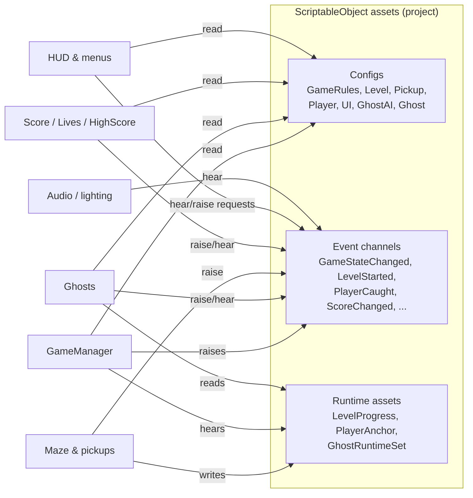
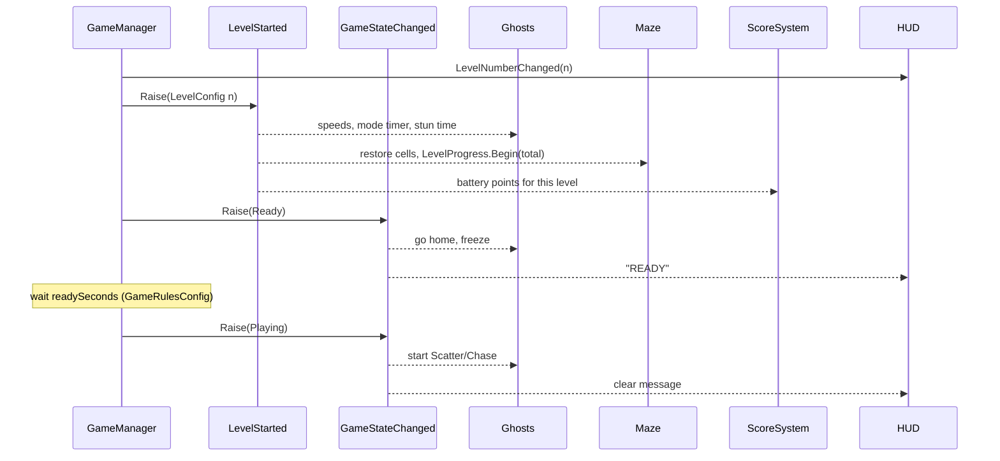
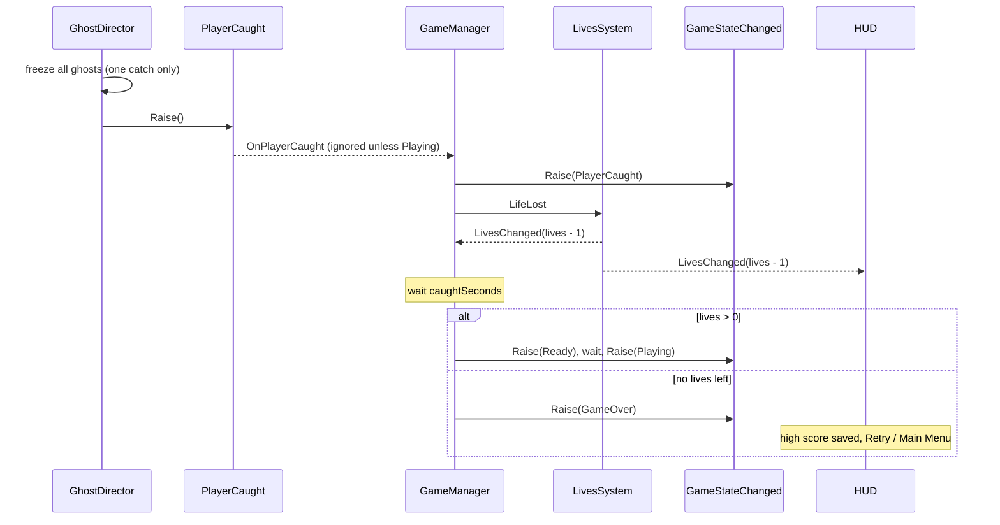
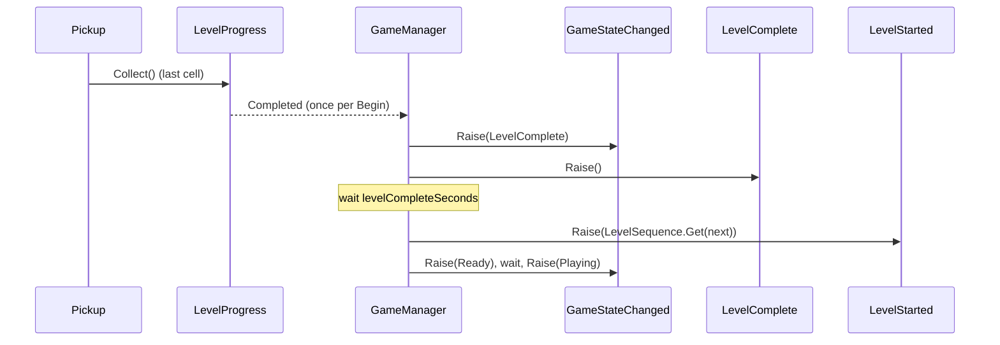

# Architecture: Scriptable Objects and Event Broadcasting

The reference for the two graded core features of **Pacman Horror**, written so each section can become a slide. Every code excerpt is copied from the repo (path given above each block).

**In one sentence:** every system in the game is a component that holds references to *assets*, either config assets it reads or event channel assets it raises and hears. No system holds a reference to another system.



## 1. Scriptable Objects

Three roles, all essential to the game loop:

1. **Config assets.** Every tunable number and UI string. Designers balance the game in the Inspector, and each replay level is just another asset.
2. **Event channels.** The event bus *is* a set of assets (section 2).
3. **Runtime assets.** Shared live state (cells left, where the player is, which ghosts exist) that any scene object can reach without searching the scene.

### Asset table

| Asset | Holds | Read by | Why an asset, not a constant |
| --- | --- | --- | --- |
| `GameRulesConfig` | Starting lives (3), extra life score (10,000), Ready / Caught / LevelComplete / GameOver seconds, max life icons, scene names, save file name | GameManager, ScoreSystem, LivesSystem, HighScoreSystem, HUD builder, GameOverView | One place to balance pacing; tests make a copy with 0.05 s timings instead of patching code |
| `LevelConfig_Level1..3` | Ghost speeds, Scatter/Chase timer, frightened time (Dev B); battery points 100 / 300 / 500 | Ghosts (via `LevelStarted`), ScoreSystem | "Each replay is harder" becomes data: a harder level is a new asset, not a code branch |
| `LevelSequence` | Ordered list of `LevelConfig`; past the end the last repeats | GameManager | Level order and difficulty curve change without code |
| `PickupConfig_Cell / Flare / Battery` | Kind, display name, points (10 / 50 / level's), counts toward level | Pickups (A), ScoreSystem, audio | Pickups and score agree on values with no shared code; the payload of `PickupCollected` *is* the config |
| `PlayerConfig` | Move speed, look sensitivity, battery max, drain, recharge, empty threshold | Player and flashlight (A) | Feel and battery tension are tuned during playtests |
| `GhostAIConfig`, `GhostConfig_*` | Repath interval, beam checks, banish combo 200/400/800/1600; per-ghost personality | Ghosts (B) | Four personalities share one prefab; the config is the difference |
| `UiConfig` | Title, state messages, HUD formats, controls list, volume key and default | Every view | Text changes (or translation) without opening a scene |
| `LevelProgress` *(runtime)* | Cells total / collected; `Completed` once per `Begin` | Maze writes (A), GameManager listens | Maze and GameManager never reference each other |
| `PlayerAnchor` *(runtime)* | The player's Transform | Ghosts, flashlight beam | Replaces `FindObjectOfType<Player>()` |
| `GhostRuntimeSet` *(runtime)* | The live ghosts | GhostDirector, beam sensor | Replaces scene searches for ghosts |

### Config excerpt

`Assets/_Project/Scripts/Core/Configs/GameRulesConfig.cs`

```csharp
    // The rules of one game: lives, the extra life, how long each GameManager state lasts,
    // and the scenes it moves between. One asset for the whole game.
    [CreateAssetMenu(fileName = "GameRulesConfig", menuName = "Game/Configs/Game Rules Config")]
    public sealed class GameRulesConfig : ScriptableObject
    {
        [Header("Lives")]
        [Tooltip("Lives at the start of a new game.")]
        [Min(1)] [SerializeField] int startingLives = 3;

        [Tooltip("Score that awards one extra life. Awarded once per game, as in the original. 0 turns it off.")]
        [Min(0)] [SerializeField] int extraLifeScore = 10000;
```

Fields are private, validated (`[Min]`), documented (`[Tooltip]`) and exposed read-only, so no system can change the rules at runtime.

### Runtime asset excerpt

`Assets/_Project/Scripts/Core/LevelProgress.cs`

```csharp
        // Play sessions. Start clean whenever the asset is (re)loaded.
        void OnEnable() => counter.Begin(0);

        public void Begin(int totalCells)
        {
            counter.Begin(totalCells);
            Changed?.Invoke(this);
        }

        public void Collect()
        {
            bool finished = counter.Collect();
            Changed?.Invoke(this);

            if (finished)
                Completed?.Invoke();
        }
```

The counting rules live in a plain C# class (`LevelProgressCounter`) inside the same file, so "completes exactly once per `Begin`" is unit tested without a scene.

## 2. Event Broadcasting

An **event channel** is a ScriptableObject asset with a C# event. A raiser and its listeners each hold a reference to the *same asset*; neither knows the other exists. Adding a listener (for example audio) never touches the raiser.

`Assets/_Project/Scripts/Events/EventChannel.cs`

```csharp
    // A ScriptableObject event channel that carries a value.
    // A system calls Raise(value); any system that cares subscribes to Raised.
    // The raiser never knows who is listening.
    public abstract class EventChannel<T> : EventChannelBase
    {
        public event Action<T> Raised;

        public override int ListenerCount => Raised?.GetInvocationList().Length ?? 0;

        public void Raise(T value)
        {
            if (logRaises)
                Debug.Log($"[{name}] raised {value}", this);

            Raised?.Invoke(value);
        }
    }
```

Each payload type is a one-line `sealed` subclass with `[CreateAssetMenu]` (`IntEventChannel : EventChannel<int>`, `GameStateEventChannel : EventChannel<GameState>`, ...). Designers can also wire responses in the Inspector with a listener component:

`Assets/_Project/Scripts/Events/EventListener.cs`

```csharp
        void OnEnable()
        {
            if (channel != null)
                channel.Raised += Respond;
        }

        void OnDisable()
        {
            if (channel != null)
                channel.Raised -= Respond;
        }
```

### Channel table

| Channel | Payload | Raised by | Heard by |
| --- | --- | --- | --- |
| `GameStateChanged` | `GameState` | GameManager | Ghosts, player, HUD, pause, cursor, game over, high score, audio, lighting |
| `LevelStarted` | `LevelConfig` | GameManager (before `Ready`) | Ghosts, score, maze |
| `LevelNumberChanged` | `int` | GameManager | HUD |
| `LevelComplete` | none | GameManager | Audio, lighting |
| `NewGameStarted` | none | GameManager | Score, lives, game over screen |
| `LifeLost` | none | GameManager | LivesSystem |
| `LivesChanged` | `int` | LivesSystem | GameManager, HUD |
| `ExtraLifeAwarded` | none | ScoreSystem | LivesSystem, audio |
| `ScoreChanged` | `int` | ScoreSystem | HUD, high score, game over, audio |
| `HighScoreChanged` | `int` | HighScoreSystem | HUD, main menu, game over |
| `PickupCollected` | `PickupConfig` | Cell and battery pickups | Score, audio, VFX |
| `FlareCollected` | none | Flare pickup | Ghosts, score, lighting, audio |
| `PlayerCaught` | none | GhostDirector | GameManager, lighting, audio |
| `GhostBanished` | `GhostBanishedInfo` | GhostDirector | Score, audio, VFX |
| `ModeChanged` | `GhostModeChange` | GhostDirector | Ghosts, audio |
| `BatteryChanged` | `float` 0 to 1 | Flashlight | HUD, audio |
| `PauseRequested` | `bool` | Pause menu | PauseController |
| `PauseChanged` | `bool` | PauseController | Pause menu, cursor, audio |
| `RestartRequested` | none | Game over screen | GameManager |
| `MainMenuRequested` | none | Pause and game over screens | GameManager, HighScoreSystem |

### Start of a level



### Player caught



The catch handler, `Assets/_Project/Scripts/Systems/GameManager.cs`:

```csharp
        void OnPlayerCaught()
        {
            // The ghosts raise this once per catch; anything outside Playing is a leftover.
            if (state != GameState.Playing)
                return;

            StopAllCoroutines();
            StartCoroutine(Caught());
        }

        IEnumerator Caught()
        {
            SetState(GameState.PlayerCaught);
            LoseLife();

            yield return Wait(rules.CaughtSeconds);

            // Collected cells stay collected: only the ghosts and the player go back to start.
            if (lives > 0)
            {
                yield return ReadyThenPlay();
                yield break;
            }

            // HighScoreSystem saves on GameOver; the game over screen offers Retry or Main Menu.
            SetState(GameState.GameOver);
        }
```

### Level complete



### Score: three sources, zero references

`Assets/_Project/Scripts/Systems/ScoreSystem.cs`

```csharp
        void OnFlare()
        {
            if (flare != null)
                Add(flare.PointsFor(level));
        }

        void OnBanished(GhostBanishedInfo info) => Add(info.Points);

        void Add(int points)
        {
            if (points <= 0)
                return;

            bool earnedLife = keeper.Add(points);

            if (scoreChanged != null)
                scoreChanged.Raise(keeper.Score);
            if (earnedLife && extraLifeAwarded != null)
                extraLifeAwarded.Raise();
        }
```

## 3. Why this is efficient

- **No scene searches.** No `FindObjectOfType`, `GameObject.Find` or `SendMessage` in game code. Shared objects are reached through runtime assets (`PlayerAnchor`, `GhostRuntimeSet`, `LevelProgress`).
- **No polling.** Nothing checks a value every frame to see if it changed. The HUD redraws only when a channel raises; GameManager's timers are coroutines with one `WaitForSeconds` each; pause uses an Input System callback.
- **Direct C# delegate calls.** A raise is one delegate invocation per listener: no reflection, no string keys, no boxing for value payloads (`EventChannel<int>` passes an `int`).
- **No leaks.** Every listener subscribes in `OnEnable` and unsubscribes in `OnDisable`. In Play mode each channel's Inspector shows its live listener count, so a leak is visible.
- **No singletons or statics.** Systems can be removed, duplicated in tests, or run in any scene. The project even runs with domain reload off, which static state would break.
- **Plain C# rules, covered by tests.** `ScoreKeeper`, `LivesKeeper`, `LevelProgressCounter` and `JsonHighScoreStore` hold the rules and are unit tested; the MonoBehaviours only connect them to channels. PlayMode tests drive GameManager through freshly created channels, which only works because nothing is hard-wired.
- **Data-driven difficulty.** Each replay is a different `LevelConfig`; nothing branches on a level number.

## 4. Debugging tools

- **Log Raises** on any channel asset logs each raise and each listener that hears it.
- **Raise** in a Void channel's context menu fires it by hand (for example `PlayerCaught`).
- **Game > Systems > Validate Setup** reports every unwired channel or config in the scenes and prefabs.
