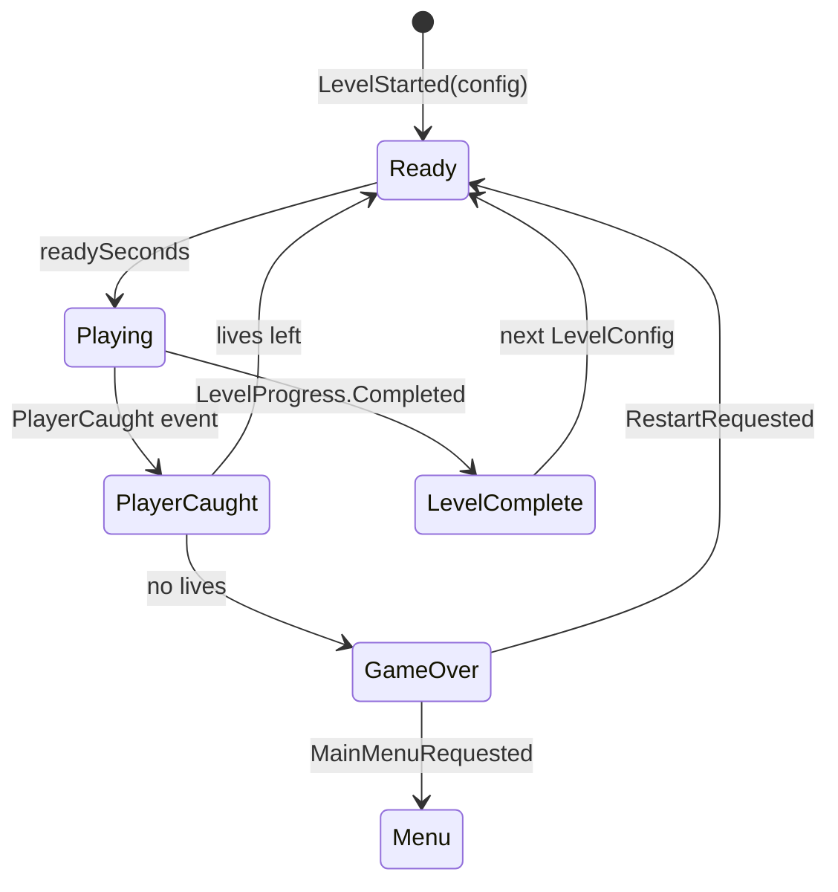

# Technical Documentation Deck: Outline

Slide-by-slide content, ready to paste into Google Slides or PowerPoint. Each slide has a title, 3 to 5 bullets, what to show (a code excerpt copied from the repo or a diagram from `Docs/Architecture-ScriptableObjects-and-Events.md`), and a speaker note.

Owners: slides 1 to 8 and 12 to 13 are Dev C's. Slides 9 to 11 are placeholders for Dev A, Dev B and Dev D to fill in.

Mermaid diagrams can be rendered to images at <https://mermaid.live> (paste, then export PNG/SVG).

---

## Slide 1: Blackout Maze

- *Working title*, TODO: final game name
- Game Jam 1: Retro Revolution
- Team: TODO: add names (Dev A, Dev B, Dev C, Dev D)
- TODO: date / course

**Show:** title screen screenshot (`MainMenu` scene) once Dev D has styled it.

**Speaker note:** "We remade Pac-Man as a first-person horror game. This deck explains how it is built, focusing on our two core features: Scriptable Objects and Event Broadcasting."

---

## Slide 2: Retro title and new genre

- **Retro title:** Pac-Man (Namco, 1980), arcade maze chase
- **New genre:** first-person survival horror, in 3D
- Same loop: clear the maze, avoid four ghosts, turn the tables with a power pellet
- New perspective: you are *inside* the maze, in the dark, with a flashlight

**Show:** side by side: an original Pac-Man screenshot and a first-person corridor screenshot (TODO once the maze exists).

**Speaker note:** "Pac-Man's view is from above: you always see every ghost. We put the camera inside the maze and turned the lights off. The rules stay the same, but now they are scary."

---

## Slide 3: Why this combination

- Pac-Man is already a horror premise: being hunted through corridors by things that never stop
- The top-down view removes the fear; first person and darkness bring it back
- Ghost personalities matter more when you cannot see them: you learn them by how they find you
- The power pellet becomes a flare, a moment of light and safety: the classic horror rhythm of tension and release
- The fruit becomes a battery: risk versus reward, since your only light runs out

**Show:** one atmospheric screenshot (TODO, Dev D).

**Speaker note:** "We did not bolt horror onto Pac-Man. Pac-Man is a chase game with a predator-prey reversal, which is exactly what survival horror is built on."

---

## Slide 4: Gameplay loop mapping

| Pac-Man (1980) | Blackout Maze |
| --- | --- |
| Pellet (10 pts) | Power cell (10 pts) |
| Power pellet (50 pts), ghosts turn blue | Flare (50 pts), ghosts are frightened |
| Eat ghosts: 200, 400, 800, 1600 | Banish specters: 200, 400, 800, 1600 |
| Fruit (100 to 5000 pts by level) | Battery (100, 300, 500 ... by level), recharges the flashlight |
| Blinky, Pinky, Inky, Clyde personalities | Four specters with the same targeting rules |
| Scatter / Chase timer | Same timer, per level |
| 3 lives, extra life at 10,000 | 3 lives, extra life at 10,000 |
| Clear all pellets to finish the level | Collect all cells to finish the level |
| Each level is faster | Each level is a harder `LevelConfig` |

**Show:** the table.

**Speaker note:** "Every rule on the left still exists on the right, and every number on the right lives in a ScriptableObject, which is the next part."

---

## Slide 5: Architecture overview

- Systems never reference each other. They reference **assets**
- **Config assets:** every number and UI string
- **Event channel assets:** the event bus
- **Runtime assets:** shared live state, with no scene searches
- One `Game` scene; each package (maze, ghosts, systems, art) plugs in through channels

**Show:** the flowchart at the top of `Docs/Architecture-ScriptableObjects-and-Events.md`.

**Speaker note:** "If you remember one thing: every arrow in this diagram goes through an asset. That is why four people could build the ghosts, the maze and the UI separately and have them work together."

---

## Slide 6: Scriptable Objects, configs

- 10+ config assets: `GameRulesConfig`, `LevelConfig` x3, `LevelSequence`, `PickupConfig` x3, `PlayerConfig`, `GhostAIConfig`, `GhostConfig` x4, `UiConfig`
- "Each replay is harder" is data: `LevelSequence` hands GameManager the next `LevelConfig`
- Pickups carry their own `PickupConfig`, and the `PickupCollected` event's payload *is* the config
- Validated in the Inspector (`[Min]`, `[Range]`, `[Tooltip]`) and checked by tests (`ConfigAssetTests`)

**Show:** `GameRulesConfig.cs` excerpt (architecture doc, section 1) and an Inspector screenshot of `LevelConfig_Level2`.

```csharp
    [CreateAssetMenu(fileName = "GameRulesConfig", menuName = "Game/Configs/Game Rules Config")]
    public sealed class GameRulesConfig : ScriptableObject
    {
        [Header("Lives")]
        [Tooltip("Lives at the start of a new game.")]
        [Min(1)] [SerializeField] int startingLives = 3;
```

**Speaker note:** "No tunable number is hard-coded. Our PlayMode tests even create their own GameRulesConfig with 0.05 second timings, so a full game over runs in under a second."

---

## Slide 7: Scriptable Objects, runtime state

- `LevelProgress`: cells left. The maze writes it, GameManager listens for `Completed`
- `PlayerAnchor`: the player's Transform, which the ghosts aim at
- `GhostRuntimeSet`: live ghosts, read by the director and the flashlight beam
- They replace `FindObjectOfType`, singletons and static fields
- They reset themselves, which matters because our project runs with domain reload off

**Show:** `LevelProgress.cs` excerpt (architecture doc, section 1).

**Speaker note:** "The maze and the GameManager never reference each other. The maze counts cells into an asset; the GameManager listens to that asset."

---

## Slide 8: Event Broadcasting

- An event channel is a ScriptableObject with a C# event: `Raise(value)`, `Raised += handler`
- 20 channels: game state, level, score, lives, pickups, ghosts, pause, UI requests
- The raiser never knows who listens, so audio and VFX plug in without touching gameplay code
- Subscribe in `OnEnable`, unsubscribe in `OnDisable`; the Inspector shows live listener counts
- **Log Raises** on any channel traces the whole chain in the Console

**Show:** `EventChannel.cs` (full, 20 lines) and the channel table.

```csharp
    public abstract class EventChannel<T> : EventChannelBase
    {
        public event Action<T> Raised;

        public override int ListenerCount => Raised?.GetInvocationList().Length ?? 0;

        public void Raise(T value)
        {
            if (logRaises)
                Debug.Log($"[{name}] raised {value}", this);

            Raised?.Invoke(value);
        }
    }
```

**Speaker note:** "This class is the whole event system: no reflection, no strings, no global static bus. Each payload type is a one-line subclass."

---

## Slide 9 *(Dev A)*: Player, maze and collision detection

- TODO (Dev A): first-person controller (physics, CharacterController or Rigidbody)
- TODO: pickups via trigger colliders, raising `PickupCollected` / `FlareCollected`
- TODO: maze building and `LevelProgress.Begin`
- TODO: flashlight battery and `BatteryChanged`
- TODO: Physics Materials, if used

**Show:** TODO: code excerpt of a pickup's `OnTriggerEnter`, collision layer diagram.

**Speaker note:** TODO (Dev A).

---

## Slide 10 *(Dev B)*: Ghost AI and performance

- TODO (Dev B): four personalities (targeting rules), Scatter/Chase timer, frightened and banish combo
- TODO: NavMesh agents, repath every 0.25 s only when the target moved
- TODO: flashlight beam check 10 times a second, distance check first
- TODO: `GhostRuntimeSet` instead of scene searches; trigger-based catching

**Show:** the ghost state diagram from `Docs/Package-B-Ghost-AI.md`, and the targeting code.

**Speaker note:** TODO (Dev B). Source: "Notes for the Ghost AI slides" in `Docs/Package-B-Ghost-AI.md`.

---

## Slide 11 *(Dev D)*: Lighting, audio and atmosphere

- TODO (Dev D): URP lighting setup, darkness and the flashlight
- TODO: per-ghost lights, flare light
- TODO: audio driven by channels (`GameStateChanged`, `ModeChanged`, `PlayerCaught`, `GhostBanished`, ...)
- TODO: QA notes

**Show:** TODO: before/after lighting screenshots.

**Speaker note:** TODO (Dev D).

---

## Slide 12: Game flow and UI

- GameManager states: Boot, Menu, Ready, Playing, PlayerCaught, LevelComplete, GameOver
- Every transition is an event; the ghosts, player, HUD and audio react on their own
- Pause is `Time.timeScale = 0` and a `PauseChanged` event, not a game state
- HUD and menus read only event payloads and `UiConfig`; buttons raise *requests* (`RestartRequested`, `MainMenuRequested`, `PauseRequested`)
- High score saved as JSON (`persistentDataPath`), robust to missing or corrupt files

**Show:** the "Player caught" sequence diagram (architecture doc, section 2), and the `OnPlayerCaught` / `Caught()` excerpt.



**Speaker note:** "GameManager never calls the ghosts or the player. It announces a state and they react. That is also how we test it: the tests create their own channels and play a whole game without loading the Game scene."

---

## Slide 13: Why it performs, and how we test it

- No `Find`, no singletons, no polling: the HUD redraws only on events, timers are coroutines
- Runtime sets and anchors instead of scene searches
- Rules in plain C# (`ScoreKeeper`, `LivesKeeper`, `LevelProgressCounter`, `JsonHighScoreStore`) with EditMode tests
- PlayMode tests: catches, game over, retry, level complete, pause, and the real `Game` scene from Ready to Game Over
- TODO: final test counts from the Test Runner at submission (at the time of writing: 43 EditMode, 20 PlayMode, all passing)

**Show:** Test Runner screenshot with everything green.

**Speaker note:** "Because systems only talk through assets, we could test each one on its own, and the same design keeps runtime cost to one delegate call per listener."
