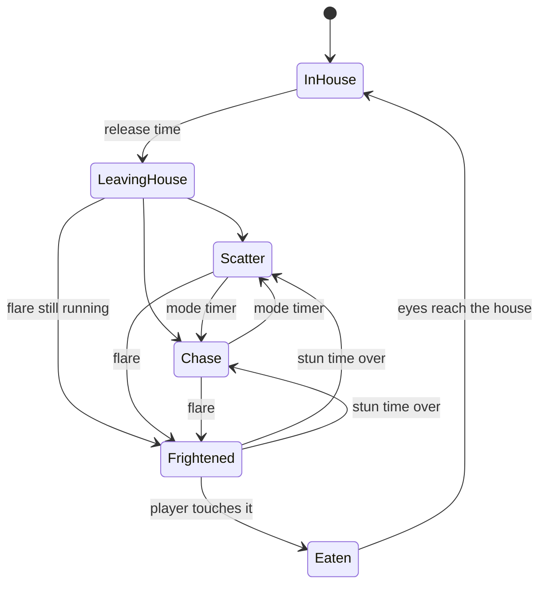

# Package B: Ghost AI

Owner: Dev B. Branch `feature/B1-B8-ghost-ai`, built on top of `feature/C1-event-framework-draft`.

Four specters with the original Pac-Man personalities. They walk the maze with NavMesh agents, follow the global Scatter/Chase timer, get frightened by flares, catch the player, can be banished for combo points, and are slowed by the flashlight beam. They talk to the rest of the game only through ScriptableObject event channels, so this package runs on its own in the sandbox scene and drops into the real maze without code changes.

## What is in the package

| Path (under `Assets/_Project`) | Contents |
| --- | --- |
| `Scripts/Ghosts/` | Runtime code: `Ghost`, `GhostDirector`, `ScatterChaseTimer`, `GhostTargeting`, `FlashlightBeamSensor`, `GhostMazeLayout`, `GhostRuntimeSet`, `GhostAIConfig`, placeholder `GhostVisuals`, ghost event channels |
| `ScriptableObjects/Configs/` | `LevelConfig_Level1..3`, `GhostConfig_Blinky/Pinky/Inky/Clyde`, `GhostAIConfig` |
| `ScriptableObjects/Events/` | Channel assets: `GameStateChanged`, `LevelStarted`, `FlareCollected`, `ModeChanged`, `PlayerCaught`, `GhostBanished` |
| `ScriptableObjects/Runtime/` | `GhostRuntimeSet`, `PlayerAnchor` |
| `Prefabs/Ghosts/` | `Ghost_Base` plus one Prefab Variant per ghost |
| `Editor/Ghosts/` | Live Inspector read-outs, and the builder behind **Game > Ghosts** |
| `Dev/GhostSandbox/` | Test-only maze, player, flare pickups and a stand-in GameManager. Delete once the real ones exist |
| `Tests/` | 20 EditMode and 11 PlayMode tests |

The event framework, `GameState`, `LevelConfig`, `GhostConfig` and `TransformAnchor` in `Scripts/Events` and `Scripts/Core` are a draft written for Dev C, on its own branch. Dev C owns them and can rename or extend them.

## How the ghosts connect to everything else

| Channel | Ghost side | Other side |
| --- | --- | --- |
| `GameStateChanged` | Listen. `Ready` puts every ghost home and frozen. `Playing` starts them. Any other state freezes them | Raised by GameManager (C) |
| `LevelStarted` (new) | Listen. Speeds, mode timer and stun time come from this LevelConfig | Raised by GameManager before `Ready` |
| `FlareCollected` | Listen. Every ghost in the maze becomes Frightened | Raised by the flare pickup (A) |
| `ModeChanged` | Raised by `GhostDirector`, heard by every `Ghost` | Audio, for the siren (D) |
| `PlayerCaught` | Raised once per catch. The ghosts freeze themselves at once | GameManager, lives UI, lighting, audio |
| `GhostBanished` | Raised with ghost, combo (1 to 4), points and position | Score (C), audio and VFX (D) |

Two runtime assets replace scene searches. `GhostRuntimeSet` holds the live ghosts; each ghost adds itself on enable, and the director and the beam sensor read the set. `PlayerAnchor` holds the player's Transform; the player sets it with `TransformAnchorBinder`.

## Plugging it in

### Dev A: maze, player, pickups

- **Maze points:** put one `GhostMazeLayout` in the scene. The maze builder calls `Configure(tileSize, houseExit, houseInside, topLeft, topRight, bottomLeft, bottomRight)` with marker Transforms; they can also be placed by hand. Then point `GhostDirector.layout` at it.
- **NavMesh:** bake after the walls exist. Mark the walls *Not Walkable* (a `NavMeshModifier`) so the tops of the walls get no NavMesh. Put the house door on a layer the bake leaves out (the sandbox uses Ignore Raycast): the ghosts can then walk through it, while its collider still blocks the player. Ghost agents only switch on at `Ready`, so a builder can spawn the ghosts before a runtime bake.
- **Ghost spawns:** `Ghost_Blinky` goes just outside the house door, and the other three go inside. Wherever a ghost is spawned becomes its home.
- **Player:** tag it `Player` and add `TransformAnchorBinder` pointing at `PlayerAnchor`. The ghosts use its position and its forward direction; looking up or down does not change their aim.
- **Flashlight:** add `FlashlightBeamSensor` to the spot Light. When the light is off or its intensity is 0, it slows nobody.
- **Flare pickup:** raise `FlareCollected`.
- **Warp doors:** not handled yet. If they become NavMeshLinks, the ghosts will walk through them. Teleporting across needs a small addition in `Ghost`.

### Dev C: systems, UI

- **Order of events:** `LevelStarted(config)`, then `Ready`, then `Playing`. On `PlayerCaught`: raise `GameStateChanged(PlayerCaught)`, run the caught animation, then `Ready` and `Playing` again. `Ready` sends every ghost home.
- **Score:** add `GhostBanishedInfo.Points` as it is. The combo values (200, 400, 800, 1600) live in `GhostAIConfig`. Move them to a score config if that fits better, since score rules are yours.
- **LevelConfig:** add the battery bonus per level and anything else GameManager needs. Leave the ghost section as it is.
- **Pause:** `Time.timeScale = 0` already freezes the ghosts. If you add a `Paused` GameState instead, the director needs a one-line change; there is a comment in `GhostDirector.OnGameStateChanged`.
- **Channel table:** add `LevelStarted`, and the payloads of `ModeChanged` (mode and seconds) and `GhostBanished`.

### Dev D: art, lighting, audio

- Replace the capsule and `GhostVisuals` under `Ghost_Base`; all four variants follow. Each ghost's color is in its GhostConfig.
- Per-ghost hooks: `Ghost.StateChanged` (UnityEvent: blue on Frightened, eyes only on Eaten) and `Ghost.IsRecovering` (true during the last seconds of Frightened, for the flicker).
- Audio: `GhostModeEventListener` for siren changes, `GhostBanishedEventListener` for banish sounds.
- Lights: one faint point light per ghost (4 total), no shadows.

## Behaviour decisions (ask Dev B before changing)

- A flare frightens every ghost in the maze. Ghosts still in the house become frightened when they come out, unless that same flare already banished them.
- Touching a frightened ghost banishes it. The combo resets with every flare, and a second flare also restarts the countdown.
- The Scatter/Chase timer pauses while ghosts are frightened, as in the original.
- Ghosts leave the house on a timer (Pinky after 1 s, Inky after 4 s, Clyde after 8 s) rather than a pellet counter, so the ghosts need no pellet data.
- The flashlight halves the speed of a ghost in Scatter, Chase or Frightened, or one leaving the house. Eyes are never slowed.
- Ghosts pass through each other like the originals, so they never jam a corridor. They do not reverse direction when the mode changes.

## Testing it on its own

Open `Assets/_Project/Dev/GhostSandbox/GhostSandbox.unity` and press Play.

| Input | Action |
| --- | --- |
| Click | Lock the mouse, then toggle the flashlight |
| WASD / arrows | Move |
| F | Collect a flare (same as walking into one of the orange flares) |
| N | Next level (faster ghosts, shorter stun) |
| R | Restart |
| Tab | Top-down map |
| Esc | Free the mouse |

Debug tools: set **Force Mode** on Ghost Director, read each ghost's live state in its Inspector, turn on Gizmos to see each ghost's aim point and path, or use the director's context menu **Debug/Start Round Now** in a scene without a GameManager. **Game > Ghosts > Rebuild Ghost Sandbox Scene** regenerates the sandbox. It never overwrites the configs or prefabs.

Tests: **Window > General > Test Runner**. EditMode tests cover the mode timer, the four targeting rules, the combo points and the channels. PlayMode tests play the sandbox: house release, chase and catch, Pinky's aim, flare and recovery, banish combo and return, a single catch when two ghosts touch at once, reset after a catch, beam slow-down and wall occlusion, throttled path requests, and level speeds.

## Notes for the Ghost AI slides

- Each ghost asks for a new path at most every 0.25 s, and skips the request when its target has not moved.
- The beam check runs 10 times a second. A ghost out of range costs one distance check; only nearby ghosts get the angle test and the raycast.
- Catching uses a trigger collider, with no per-frame distance checks. The ghost and flashlight code reads `GhostRuntimeSet` instead of calling `FindObjectOfType`.
- The targeting rules and the mode timer are plain C#, so they are unit tested without a scene.

## What needs the other packages

- The real maze and its NavMesh (A). The sandbox maze is only a stand-in.
- The real player, the flashlight battery, and the flare pickups (A, D).
- GameManager flow, score, lives and HUD (C). `StandaloneGameFlow` only stands in.
- Final ghost models, lights and sounds (D).
- Balancing speeds and timers in the real maze (everyone).
